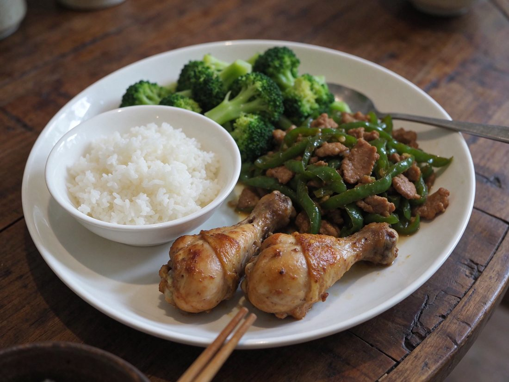
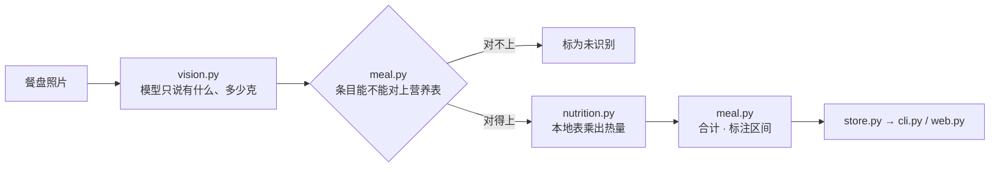

# Chengxin · Plate Calorie Estimator

[](https://github.com/wushiyi105-jpg/chengxin/actions) []() [](./LICENSE) [](https://codecov.io/gh/wushiyi105-jpg/chengxin)

Photograph a plate and it tells you roughly how many calories are on it.

The split is rigid: **the model only answers "what is this, roughly how many grams", calories are always multiplied out locally from the nutrition table.** The model may not compute calories, nor say things like "about 800 kcal" — that is not its sentence to say.


## Why split it this way

Ask a model directly "how many kcal is this plate" and it answers generously: 200 kcal for rice, 300 for a drumstick, 780 total, in a tone as confident as if it had weighed the thing.

None of those numbers can be verified. Whether the rice is 150g or 200g, it does not actually know; whether the drumstick is roasted or fried, it cannot reliably tell. But "150 kcal per 100g" is something you can look up.

So I separated two things:

- The model looks at weight (image only, grams only)
- The program computes calories (grams × energy per 100g from the table)

That way every kilocalorie traces to "which food, how many grams, which row of the table".

## What one run looks like

The sample is this one (top-down on a white porcelain plate: rice, broccoli, green-pepper stir-fried pork, two drumsticks):



```bash
python -m chengxin analyze samples/meal-1.jpg --name "周三午饭"
```

```
=== 餐 [1] 周三午饭 · 4 样 ===
场景：家常午餐
· 米饭 150g（alias） —— 174 千卡（148–200，把握 high）
· 西兰花 100g（exact） —— 36 千卡（31–41，把握 high）
· 青椒 150g（fuzzy） —— 33 千卡（28–38，把握 high）
· 鸡腿 200g（alias） —— 362 千卡（308–416，把握 high）
合计 605 千卡，区间 514–696；覆盖率 100%
大概 605 千卡，正常一顿饭的量。
```

**There is a real problem here and I am not hiding it:** that dish was green-pepper stir-fried pork; the model only reported "青椒 150 克" and the meat was missed. So 605 kcal is low — the meat and oil stir-fried in are another 100-odd kcal.

I did not tune the prompt to force it, because this kind of missed item is normal for vision models. I would rather have the program show "unrecognised things are not counted" openly: when coverage drops, the conclusion backs off on its own.

## Three constraints written into the code

**One: every weight carries a ±15% band.** Eyeballing a portion should never produce a precise number. 150g of rice gives a 148–200 kcal band, and the whole plate gets a band too.

**Two: unrecognised food is never fudged.** A name not in the nutrition table gets listed, with a few near-spelling candidates, calories recorded as `None` — never filled in with "average food, 200 kcal/100g".

**Three: coverage under 70% says the number is not accurate.**

```
覆盖率 42%，这一盘的热量实际会更高，别拿 260 千卡当准数。
```

That sentence is a branch in `meal.verdict()`, not copy writing. Below the line it fires; above the line you get "a normal meal".

## The nutrition table

`nutrition.py` holds 60-odd entries: energy, protein, fat and carbs per 100g. Taken from common items in the Chinese food composition table, rounded to whole numbers — good enough for everyday estimates, not medical advice.

Matching has three levels: exact name → alias → contains. The alias level exists to absorb the model's phrasing:

- 「白米饭」→ 米饭
- 「烤鸡腿」→ 鸡腿 (181 kcal)
- 「炸鸡腿」→ 炸鸡 (279 kcal)

**Chicken drumstick and fried chicken must be two rows.** Same 200g, one is 362 kcal, the other 558. Covering both cooking methods with one row is worse than not measuring at all.

Prefix noise (「一份」「少许」「适量」) and parenthetical notes (「鸡腿（烤）」) are stripped before matching, otherwise "一份米饭" matches nothing.

## What the vision path taught me

**Free vision models are not dependable.** I started with Zhipu's free `glm-4.6v-flash` and got a steady 429 rate limit — not one image went through. Switching to the paid `glm-4.6v-flashx` made it stable.

**DeepSeek returned an empty body that one time it looked at an image.** Same image, same prompt, empty string back — reasoning models spend the entire budget on thinking. That is also why vision has its own set of environment variables (`VISION_API_KEY` / `VISION_BASE_URL` / `VISION_MODEL`): text and vision can come from different vendors.

**A 3.2MB photo does not fit in a request.** The sample was originally 3.2MB, 4.3MB after base64. `encode_image()` shrinks anything over 900KB to 1100px at quality 82 with Pillow — 117KB after, and the model still recognises all four items. Pillow is optional: shrink if present, send the original if not.

**The base64 decoder does not complain.** Send it `###` and `base64.b64decode` raises nothing, "best-efforts" an empty string, and the program cheerfully calls the model with an empty file. The fix is `validate=True` plus a length check — both, because validate alone still decodes something for certain malformed strings.

**The model likes to copy the label into the value.** With the prompt saying `"table_note": "一句话：……"`, the returned field content was `"一句话：这是家常午餐的餐盘"`. A prefix strip keeps the report from reading "场景：一句话：……".

## Data flow

How one piece of data moves between the modules:



## Tests

```bash
python -m unittest discover -s tests
```

86 cases, all offline: vision calls are replaced by doubles, HTTP uses a real server on `port=0`. Covers three-level matching, long/short name conflicts (「红烧肉」must not be stolen by 「肉」), the ±15% band, unknown food counting zero calories, the coverage branches, malformed base64, and a data URL that is still valid after compression.

Running the tests caught a trap of my own making: `test_cli`'s `setUp` swapped `vision.recognize` for a double, and `tearDown` never swapped it back, so the next twenty-odd vision tests all ran on the fake and reported a pile of inexplicable "image not found" / "429 never appeared". That kind of cross-test pollution is nasty — each file green, the directory red. Fixed by restoring the original function in `tearDown`.

## Commands

| Command | What it does |
| --- | --- |
| `analyze <图片...> [--name] [--note] [--json]` | Read the image, compute calories, store; re-running the same image overwrites |
| `list` / `show <id>` / `rm <id>` / `stats` | List / detail / delete / stats |
| `foods [--search 名字]` | Query the nutrition table, handy for checking one food's kcal |
| `serve` | Start the Web UI at http://127.0.0.1:8771 |

The Web UI: pick an image → upload as base64 (no multipart parsing; that stuff is too easy to get wrong inside `http.server`) → result card. History on the left, click to go back to an earlier one.

## Quick start

```bash
git clone https://github.com/wushiyi105-jpg/chengxin.git && cd chengxin
cp .env.example .env      # fill in VISION_API_KEY and VISION_BASE_URL
python -m chengxin analyze samples/meal-1.jpg
```

## Design trade-offs

- **Zero runtime dependencies.** HTTP, JSON, base64, SQLite are all standard library. Pillow is only for shrinking images, and it runs without it.
- **Vision and text use separate configs.** The image reader and the text writer can be two vendors; use whichever is cheaper.
- **Recomputing the same image overwrites.** If the photo has not changed there is no reason to keep two results, it only leaves you unsure which to trust.
- **An absurd weight counts as zero.** "3000g of rice" or "0g" is treated as no estimate and marked "热量未计" — better than multiplying an absurd number into 3480 kcal.

---

Author: shiyi
Email: wushiyi105@gmail.com
GitHub: [wushiyi105-jpg](https://github.com/wushiyi105-jpg)
