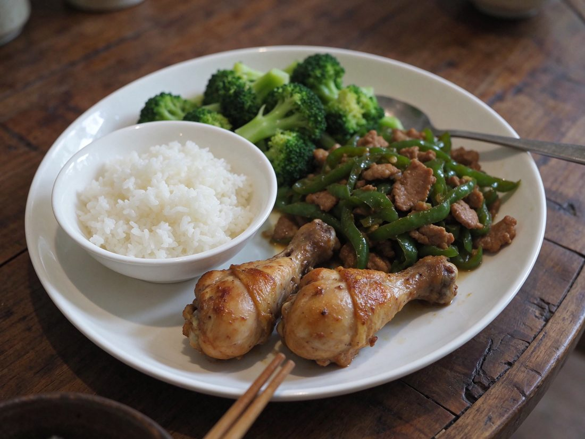

# 秤心 chengxin

[](https://github.com/wushiyi105-jpg/chengxin/actions)

拍一张餐盘照片，它告诉你这一盘大概多少热量。

分工很硬：**模型只负责「这是什么、大概多少克」，热量一律由本地营养表乘出来。** 模型不许算热量，也不许说「约 800 千卡」这种话——那不是它该说的。


## 为什么要这么分

直接问模型「这盘多少千卡」，它会给得很痛快：一份米饭 200 千卡、一个鸡腿 300 千卡、总计 780 千卡，语气笃定得像称过。

这些数字没法验证。米饭 150 克还是 200 克，它其实不知道；鸡腿是烤的还是炸的，它也未必分得清。但「150 千卡/100 克」这件事是查得到的。

所以我把两件事拆开：

- 模型看重量（只能看图，只能估克数）
- 程序算热量（克数 × 表里的每百克能量）

这样每个千卡都能追到「哪样食物、多少克、表里哪一条」。

## 跑一遍是什么样

样例是这张（俯拍白瓷盘，米饭、西兰花、青椒炒肉、两个鸡腿）：



```bash
python -m chengxin analyze samples/meal-1.jpg --name "周三午饭"
```

```
=== 餐 [1] 周三午饭 · 4 样 ===
场景：家常午餐
· 米饭 150g（alias） —— 174 千卡（148–200，把握 high）
· 西兰花 100g（exact） —— 36 千卡（31–41，把握 high）
· 青椒 150g（fuzzy） —— 33 千卡（28–38，把握 high）
· 鸡腿 200g（alias） —— 362 千卡（308–416，把握 high）
合计 605 千卡，区间 514–696；覆盖率 100%
大概 605 千卡，正常一顿饭的量。
```

**这里有个真实的问题，我不打算藏：** 那盘菜是「青椒炒肉」，模型只报了「青椒 150 克」，肉那部分被漏了。所以 605 千卡是偏低的——炒进去的肉和油大概还差 100 多千卡。

我没有为此去调提示词硬凑，因为这类漏认是视觉模型的常态。我更愿意让程序把「认不出的东西不算热量」摆在明面上：覆盖率掉下去，结论就自己认怂。

## 三个约束写死在代码里

**一、每个克数带 ±15% 的区间。** 目测份量本来就不该给精确值。150 克的米饭，热量区间是 148–200 千卡，全盘区间一起给。

**二、认不出的食物不硬凑。** 营养库里没有的名字，列出来、给几个字面相近的候选，热量记 `None`，绝不按「平均食物 200 千卡/100g」糊一个数上去。

**三、覆盖率低于 70% 就直说这数不准。**

```
覆盖率 42%，这一盘的热量实际会更高，别拿 260 千卡当准数。
```

这句话是 `meal.verdict()` 里的一条分支，不是文案。低于线就触发，高于线才给「正常一顿饭」的评价。

## 营养库

`nutrition.py` 里 60 多条，每 100 克的能量、蛋白、脂肪、碳水。数据取自中国食物成分表的常见条目，取整到个位——够日常估算，不是医学建议。

匹配是三级：完全同名 → 别名 → 包含。别名这一级是为了应付模型的措辞：

- 「白米饭」→ 米饭
- 「烤鸡腿」→ 鸡腿（181 千卡）
- 「炸鸡腿」→ 炸鸡（279 千卡）

**鸡腿和炸鸡必须是两条。** 同样的 200 克，一个 362 千卡，一个 558 千卡。用一条数据覆盖两种做法，误差比不测还糟。

前缀噪音（「一份」「少许」「适量」）和括号注释（「鸡腿（烤）」）在匹配前剥掉，不然「一份米饭」会匹配不到任何东西。

## 视觉这一路的坑

**免费视觉模型不能指望。** 一开始试的是智谱免费版 `glm-4.6v-flash`，持续 429 限流，一张图都过不去。换付费的 `glm-4.6v-flashx` 才稳定。

**DeepSeek 看图那次返回空正文。** 同一张图、同样的 prompt，DeepSeek 回了空字符串——它是推理型模型，预算全花在思考上了。这也是为什么视觉走单独的一套环境变量（`VISION_API_KEY` / `VISION_BASE_URL` / `VISION_MODEL`），文本和视觉可以用不同供应商。

**3.2MB 的原图塞不进请求。** 样例图原本 3.2MB，base64 之后 4.3MB。`encode_image()` 会在超过 900KB 时用 Pillow 缩到 1100px、质量 82——压完 117KB，模型照样认得出四样东西。Pillow 是可选依赖，装了才压，没装就走原图。

**base64 解码器不报错。** 传一段 `###` 上去，`base64.b64decode` 不抛异常，它「尽力而为」解出一个空串，然后程序欢天喜地拿空文件去调模型。修法是 `validate=True` 再检查长度，两个都要——单靠 validate 对某些畸形串还是能解出东西。

**模型爱把标签抄进值里。** 提示词写 `"table_note": "一句话：……"`，它返回的字段内容就是 `"一句话：这是家常午餐的餐盘"`。加个前缀剥离，报告里才不会出现「场景：一句话：……」。

## 测试

```bash
python -m unittest discover -s tests
```

86 个用例，全离线：视觉调用用替身接管，HTTP 用 `port=0` 起真服务再打。覆盖三级匹配、长短名冲突（「红烧肉」不能被「肉」抢走）、±15% 区间、未知食物不计热量、覆盖率分支、base64 畸形、压缩后仍是合法 data URL。

跑测试时逮到一个我自己造的坑：`test_cli` 的 `setUp` 把 `vision.recognize` 换成了替身，`tearDown` 却没换回来，于是后面二十多个视觉测试全跑在假函数上，报出一堆莫名其妙的「找不到图片」「429 没出现」。这类跨测试污染很阴——单个文件跑绿的，整个目录跑就红。修在 `tearDown` 里恢复原函数。

## 命令

| 命令 | 做什么 |
| --- | --- |
| `analyze <图片...> [--name] [--note] [--json]` | 看图算热量并存库，同一张图重算覆盖旧记录 |
| `list` / `show <id>` / `rm <id>` / `stats` | 记录列表 / 明细 / 删除 / 统计 |
| `foods [--search 名字]` | 查营养库，顺手看看某个食物多少千卡 |
| `serve` | 起网页，http://127.0.0.1:8771 |

网页端选图 → 传 base64（不解析 multipart，那玩意儿在 http.server 里太容易出错）→ 出结果卡片。左边是历史记录，点一下能翻回去看。

## 快速开始

```bash
git clone https://github.com/wushiyi105-jpg/chengxin.git && cd chengxin
cp .env.example .env      # 填 VISION_API_KEY 和 VISION_BASE_URL
python -m chengxin analyze samples/meal-1.jpg
```

## 设计取舍

- **零运行时依赖**。HTTP、JSON、base64、SQLite 全是标准库。Pillow 只用于压图，没有也能跑。
- **视觉与文本分两套配置**。看图的和写字的可以是两家供应商，谁便宜用谁。
- **同一张图重算覆盖**。照片没变就没必要留两份结果，只会让你不知道该信哪个。
- **克重不合理就归零**。模型报「3000 克米饭」或「0 克」，一律当没估出来，标「热量未计」——比拿一个荒谬数字乘出 3480 千卡好。

---

作者：shiyi
邮箱：wushiyi105@gmail.com
GitHub：[wushiyi105-jpg](https://github.com/wushiyi105-jpg)
